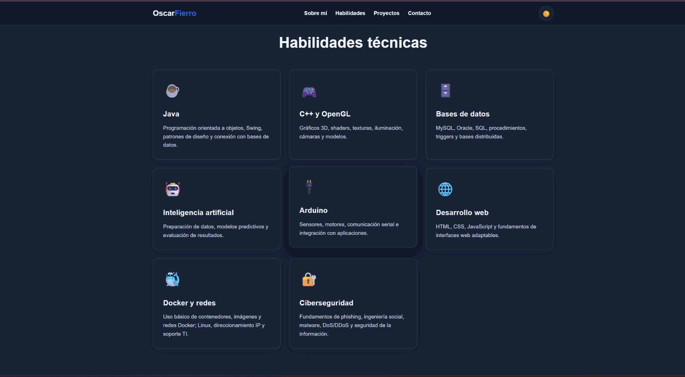
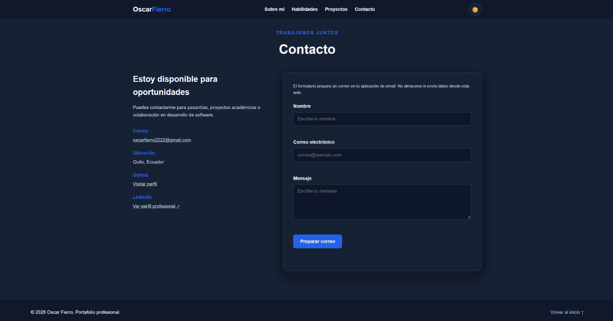

# Portafolio web — Oscar Fierro

**Sitio personal de un estudiante de Ingeniería de Software** para presentar habilidades, proyectos académicos y formas de contacto. Orientado a la búsqueda de **pasantías en desarrollo de software, backend e infraestructura TI**, con interés en aprender **DevOps**.

**Tecnologías:** HTML5 · CSS3 · JavaScript (sin frameworks) · GitHub Actions (verificación automática).

> **Estado:** aplicación estática preparada para publicarse. Este repositorio no presupone que la web esté desplegada. El formulario **no envía correos desde un servidor**: prepara un mensaje en la aplicación de correo del visitante.

## Vista previa

Las siguientes son **capturas reales proporcionadas por el autor**, en modo oscuro, para documentar el aspecto actual de la página.

### Página de inicio


<details>
<summary><strong>Ver sección de habilidades técnicas</strong></summary>



</details>

<details>
<summary><strong>Ver sección de contacto</strong></summary>



</details>

**[Ver la galería completa y las descripciones de las capturas](docs/CAPTURAS.md)** (incluye una captura adicional de vista móvil).

## Funcionalidades

- Presentación personal e información orientada a pasantías.
- Secciones **Sobre mí**, **Habilidades**, **Proyectos** y **Contacto**.
- Tarjetas de proyectos con diálogo para visualizar detalles.
- Enlaces a proyectos publicados en GitHub.
- Modo **claro/oscuro**; se recuerda la elección cuando el navegador permite almacenamiento local.
- Menú de navegación adaptable a pantallas pequeñas.
- Funciones básicas de accesibilidad: navegación con teclado, enlace para saltar al contenido, gestión del foco en diálogos y soporte para movimiento reducido.
- Formulario de contacto con validaciones en el navegador que abre un **`mailto:`**; no almacena ni transmite mensajes por cuenta propia.

## Tecnologías y requisitos

| Herramienta | Uso |
| --- | --- |
| HTML5 | Estructura y contenido de la web. |
| CSS3 | Diseño, tarjetas, animaciones, temas y adaptación a pantallas. |
| JavaScript | Menú, tema, ventana de proyectos y contacto. |
| GitHub Actions | Validación de sintaxis y pruebas estructurales al subir cambios. |

**Para navegar la web no hay que instalar paquetes**, ni Node.js ni base de datos. Node.js 20+ solo es necesario para ejecutar las pruebas de forma local.

## Instalación y ejecución local

1. Descarga el repositorio como ZIP o clónalo desde GitHub una vez publicado.
2. Abre la **carpeta que contiene `index.html`** en Visual Studio Code.
3. Ejecuta `index.html` con **Live Server** o usa Python en la terminal:

```bash
python -m http.server 8000
```

4. Abre **http://localhost:8000** en el navegador y detén el servidor con `Ctrl+C`.

También es posible abrir `index.html` directamente, aunque un servidor local reproduce mejor las condiciones de despliegue.

## Estructura del proyecto

```text
Portafolio_OscarFierro_Documentado/
├── index.html                        # Estructura y contenido
├── styles.css                        # Estilos y diseño adaptable
├── script.js                         # Interacciones
├── README.md                         # Presentación e instrucciones
├── .gitignore                        # Archivos excluidos de Git
├── .github/workflows/ci.yml          # Integración continua
├── tests/portfolio.test.mjs          # Pruebas automatizadas
└── docs/
    ├── ARQUITECTURA.md               # Componentes y decisiones técnicas
    ├── GUIA_USO.md                   # Cómo utilizar la web
    ├── CAPTURAS.md                   # Galería y explicación visual
    ├── DESPLIEGUE.md                 # Publicación en GitHub Pages
    ├── ACTUALIZAR_GITHUB.md          # Subida y actualizaciones de archivos
    ├── MEJORAS.md                    # Cambios y futuras tareas
    ├── capturas/
    │   ├── inicio.png                # Captura suministrada: portada
    │   ├── habilidades.png           # Captura suministrada: habilidades
    │   └── contacto.png              # Captura suministrada: contacto
    ├── vista-previa.png              # Captura adicional previa
    └── vista-movil.png               # Captura de vista móvil
```

## Proyectos presentados

| Proyecto | Tecnologías mencionadas en el portafolio | Código |
| --- | --- | --- |
| Smart Parking EPN | C++, OpenGL, algoritmo Dijkstra | [Repositorio](https://github.com/OscarFierro22/Smart-Parking-EPN) |
| Sistema de facturación | Java, Swing, MySQL | Sin enlace público en esta versión |
| Cinta transportadora | C++, OpenGL, Arduino | [Repositorio](https://github.com/OscarFierro22/Cinta-Transportadora-Industria-4.0) |
| Modelo predictivo | Python, IA, análisis de datos | Sin enlace público en esta versión |

> Los enlaces de los proyectos son repositorios independientes; las tarjetas de este sitio presentan un resumen de ellos.

## Pruebas e integración continua

Con **Node.js 20+** instalado, desde la raíz del proyecto:

```bash
node --check script.js
node --test tests/*.test.mjs
```

El flujo de GitHub Actions ejecuta esas mismas verificaciones cuando se hace `push` a `main` o se abre un `pull request`. Se comprueba la **estructura del proyecto y la documentación**, no se garantiza cobertura completa de interfaz ni pruebas de extremo a extremo.

## Publicación y mantenimiento

- **[Publicar en GitHub Pages](docs/DESPLIEGUE.md)**: subir los archivos y activar Pages en la rama principal.
- **[Actualizar el repositorio](docs/ACTUALIZAR_GITHUB.md)**: cómo añadir estas capturas y nuevos cambios usando Git o la web de GitHub.
- **[Arquitectura técnica](docs/ARQUITECTURA.md)**: responsabilidades y decisiones del proyecto.
- **[Guía de uso](docs/GUIA_USO.md)**: recorrido por la interfaz.
- **[Registro de mejoras](docs/MEJORAS.md)**: cambios efectuados y mejoras pendientes.

## Privacidad y limitaciones

- El **correo electrónico mostrado en la página y en las capturas es público si haces público el repositorio**: revísalo antes de subir los archivos.
- La web no tiene un backend, una API propia ni una base de datos; no debes subir contraseñas, tokens o claves a los archivos HTML/JS.
- El formulario utiliza `mailto:` y depende de un cliente de correo configurado: no garantiza la recepción del mensaje.
- `localStorage` se utiliza para recordar la preferencia visual cuando está disponible.

## Autor

**Oscar Fierro** · [GitHub](https://github.com/OscarFierro22) · [LinkedIn](https://www.linkedin.com/in/oscar-fierro-aules)

**Licencia:** todavía no se ha seleccionado una licencia. No se atribuyen permisos de reutilización automática por publicar el código.