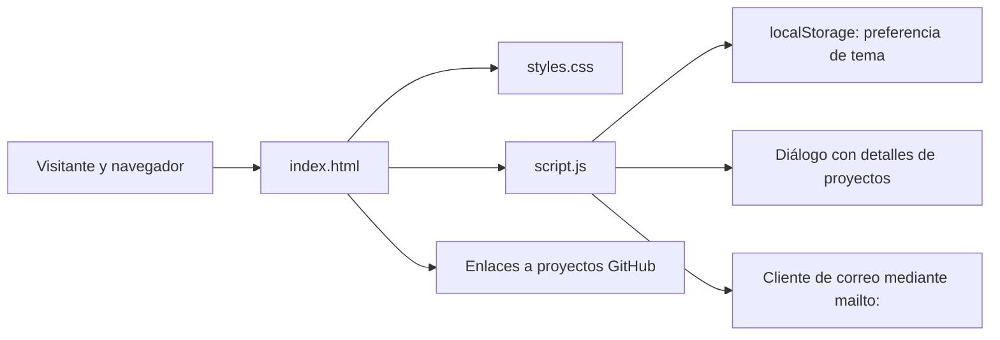
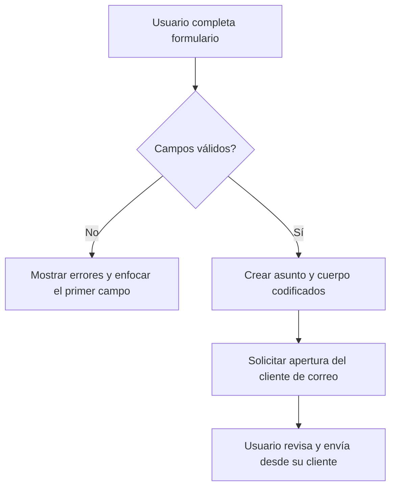

# Arquitectura técnica

## Propósito y alcance

Portafolio web **estático**, sin base de datos, autenticación, API ni servidor de aplicaciones. Puede servirse desde archivos locales o desde un servidor HTTP estático como GitHub Pages.

## Componentes

| Componente | Responsabilidad |
| --- | --- |
| `index.html` | Encabezado, secciones, enlaces, contenido de proyectos y formulario. |
| `styles.css` | Layout con grid/flex, componentes visuales, modo oscuro, estilos de foco y responsive. |
| `script.js` | Persistencia del tema, menú móvil, diálogos con gestión de foco, validaciones y construcción de `mailto:`. |
| `tests/portfolio.test.mjs` | Verifica estructura clave, rutas de ancla y ausencia de enlaces de relleno. |
| `.github/workflows/ci.yml` | Ejecuta comprobaciones en GitHub Actions con Node.js sin instalar dependencias. |

## Decisiones

1. **Sin frameworks ni proceso de compilación:** proyecto adecuado para aprender fundamentos de HTML/CSS/JavaScript y publicar rápido.
2. **Tema persistente:** usa `localStorage` cuando está disponible y respeta la preferencia del sistema en la primera visita.
3. **Interfaz adaptable:** menú desplegable en pantallas pequeñas y tarjetas ajustadas mediante media queries.
4. **Diálogos accesibles:** `role="dialog"`, `aria-modal`, enfoque inicial en botón de cierre, devolución de foco al origen y cierre con `Escape`.
5. **Seguridad de presentación:** nombres/descripciones de proyectos se insertan mediante `textContent`, no `innerHTML`; enlaces externos usan `rel="noopener noreferrer"`.
6. **Contacto sin backend:** valida los datos del formulario y compone una URL `mailto:`; no declara éxito de envío.

## Flujo de contacto

**Limitación importante:** `mailto:` depende de que el visitante tenga una aplicación o manejador de correo configurado. El sitio no sabe si el mensaje se envió y no almacena el contenido. Si se necesita envío real desde una web, hay que integrar un servicio de formularios o backend, junto con protección contra abuso y una política de privacidad.

## Datos y seguridad

- No se usan cookies de seguimiento ni llamadas a servidores propios.
- `localStorage` almacena solo la preferencia de tema (`claro`/`oscuro`).
- Se muestran datos públicos de contacto en el HTML y JS; revisar antes de poner el repositorio en modo público.
- GitHub Pages sirve archivos estáticos. No colocar secretos, claves API, tokens, contraseñas ni información privada dentro del repositorio.
- La validación de formulario es únicamente del lado del cliente; **no sustituye** la validación de un servidor si se agrega backend.

## Mantenimiento

- Contenido de proyectos: modificar los artículos `tarjeta-proyecto` en HTML y la entrada correspondiente en `descripcionesProyectos` del JS.
- Colores: variables CSS definidas en `:root` y `body.modo-oscuro`.
- Contacto: cambiar la dirección en el enlace HTML y la URL `mailto:` en JS.
- Comprobar cambios con `node --check script.js` y `node --test tests/*.test.mjs`.

## Documentación visual

Las capturas de interfaz se almacenan en `docs/capturas/` y no son recursos requeridos por la página al ejecutarse: se usan para la documentación de GitHub. [Consultar la galería](CAPTURAS.md). Mantener estas imágenes fuera de los recursos de producción evita añadir carga innecesaria al sitio.