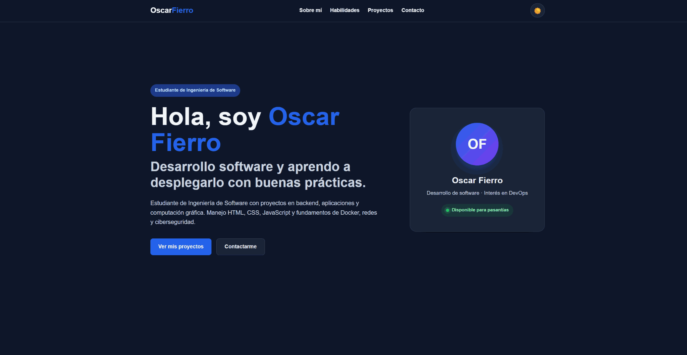

# Guía de uso

Las capturas de pantalla de esta versión se encuentran en la [galería visual](CAPTURAS.md).

## Visitantes

1. **Inicio:** presenta al estudiante y permite ir a los proyectos o al contacto.
2. **Sobre mí:** resume intereses profesionales y disponibilidad para pasantías.
3. **Habilidades:** muestra conocimientos de programación, desarrollo web, Docker/redes y fundamentos de ciberseguridad. [Ver captura](capturas/habilidades.png).
4. **Proyectos:** cada tarjeta ofrece una descripción y un botón **Ver detalles**. Dos proyectos tienen además enlace a su repositorio de GitHub.
5. **Contacto:** puedes pulsar el correo o rellenar el formulario. Este último abre el cliente de correo; **la página no envía por sí sola**. [Ver captura](capturas/contacto.png).

## Tema visual

- El botón de luna/sol cambia entre modo claro y oscuro.
- El navegador intenta recordar la elección en `localStorage`.
- Si todavía no se ha elegido un tema, se aplica la preferencia del sistema cuando está disponible.

## Pantallas pequeñas

- La navegación se oculta dentro de un botón de menú (☰).
- Pulsa el botón para mostrar los enlaces; al elegir una sección, el menú se cierra.

## Teclado y accesibilidad

- Usa `Tab` y `Shift+Tab` para recorrer controles.
- La opción **Saltar al contenido principal** aparece al navegar con el teclado.
- El diálogo de detalles se puede cerrar con `Escape`, el botón × o al hacer clic fuera de su contenido.
- Tras cerrar el diálogo, el foco regresa al botón que lo abrió.

## Contacto: qué sucede realmente

El formulario verifica que nombre, correo y mensaje tengan formato básico válido. Luego solicita al navegador abrir un correo dirigido al titular del portafolio. El envío final depende del usuario y su aplicación de correo. Si no se abre nada, usar el enlace visible de correo en la misma sección.